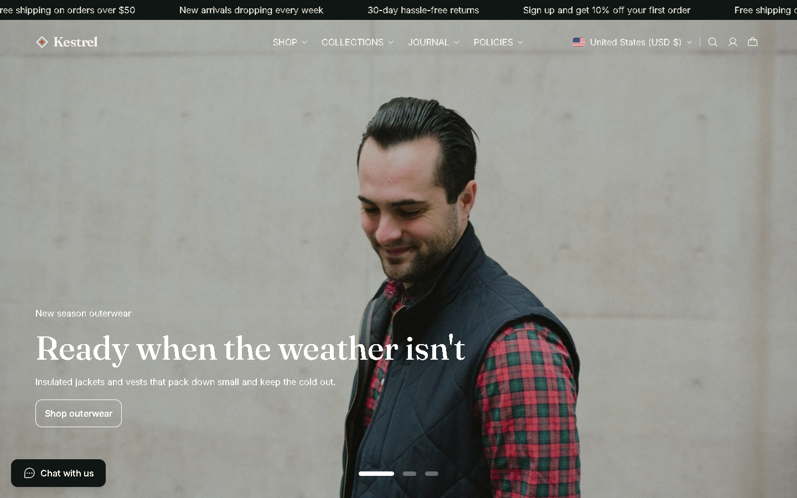

<h1 align="center">Kestrel Storefront</h1>

<p align="center">A Hydrogen storefront on React Router 7, with editable pages, a themeable design system and a Kestrel look out of the box.</p>

<p align="center">
  
</p>

## Demo

<video src="docs/assets/demo.mp4" poster="docs/assets/demo.jpg" controls muted playsinline preload="metadata" width="900"></video>

If the player does not load, open [docs/assets/demo.mp4](docs/assets/demo.mp4).

## What it is

A production-shaped Shopify Hydrogen storefront. Routes, sections, cart, search, account and SEO are here; page composition and merchandising come from a Weaverse project, so merchants edit pages in a visual editor without a redeploy.

- Storefront: server-rendered product, collection, cart, search, account and content routes
- Design system: Tailwind 4 tokens in `app/styles/theme.css`, global styles in `app/weaverse/style.tsx`
- Brand chrome: header, menus, footer and announcement bar in `app/components/layout`
- Commerce: Storefront API queries under `app/graphql`, cart and checkout through `@shopify/hydrogen`
- Content: sections registered in `app/weaverse`, rendered from the CMS project named by `WEAVERSE_PROJECT_ID`

## Requirements

- Node 22.18.0 or newer, below 25 (`.node-version` is not set)
- npm 11 (the lockfile is `package-lock.json`)

## Setup

```sh
npm ci --legacy-peer-deps
cp .env.example .env
```

Edit `.env`:

| Variable | What it does |
| --- | --- |
| `PUBLIC_STORE_DOMAIN` | Shopify store domain, for example `your-store.myshopify.com` |
| `PUBLIC_STOREFRONT_API_TOKEN` | Public Storefront API token |
| `PUBLIC_STOREFRONT_ID` | Storefront ID for the Shop Pay and analytics scripts |
| `PUBLIC_CHECKOUT_DOMAIN` | Checkout domain |
| `PUBLIC_CUSTOMER_ACCOUNT_API_CLIENT_ID` | Customer account API client, when accounts are enabled |
| `SHOP_ID` | Numeric shop ID |
| `WEAVERSE_PROJECT_ID` | Weaverse project that supplies page content |
| `WEAVERSE_API_KEY`, `WEAVERSE_HOST`, `WEAVERSE_API_BASE` | Only for preview and publishing from Studio |

`.env.example` ships placeholders. Fill in the store domain and token before running against a real store; without them the app starts but graph queries fail.

## Run

```sh
npm run dev
```

Open http://localhost:3456.

```sh
npm run build
npm run typecheck
npm test
```

`npm test` runs the Playwright unit suite in `tests/unit`.

## Design tokens

`app/styles/theme.css` holds the Tailwind theme: `--font-sans` (Inter), `--font-serif` (Fraunces), radii, and the colour scale mapped to Kestrel ink, paper, line, rust, moss and gold. `app/weaverse/style.tsx` turns the CMS section settings into CSS custom properties; it uses the same palette so CMS sections land in the same colours.

The fonts are self-hosted in `public/fonts` and declared in `app/styles/app.css`; there is no Google Fonts request at runtime.

## Content and pages

Every page is a Weaverse page: `app/routes/home.tsx` renders the `INDEX` page and `app/routes/catch-all.tsx` renders `CUSTOM` pages. A route that has no matching page returns 404. Without a Weaverse project only the route shells exist, so connect a project or point `WEAVERSE_PROJECT_ID` at your own before treating content as final.

## Layout

```
app/
  components/   layout, product, cart, account and UI components
  graphql/      Storefront API documents
  routes/       home and catch-all CMS routes plus resource routes
  styles/       app.css, theme.css
  weaverse/     section registry, global style, schema
tests/unit/     Playwright unit specs
```

## Notes

- Cart and checkout need a real store token; the demo token only reads the demo store
- Customer accounts need the Customer Account API client ID
- The 3D and model-viewer sections rely on assets uploaded in the CMS project
